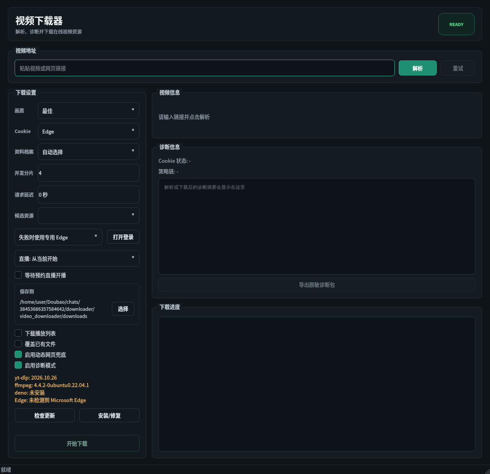
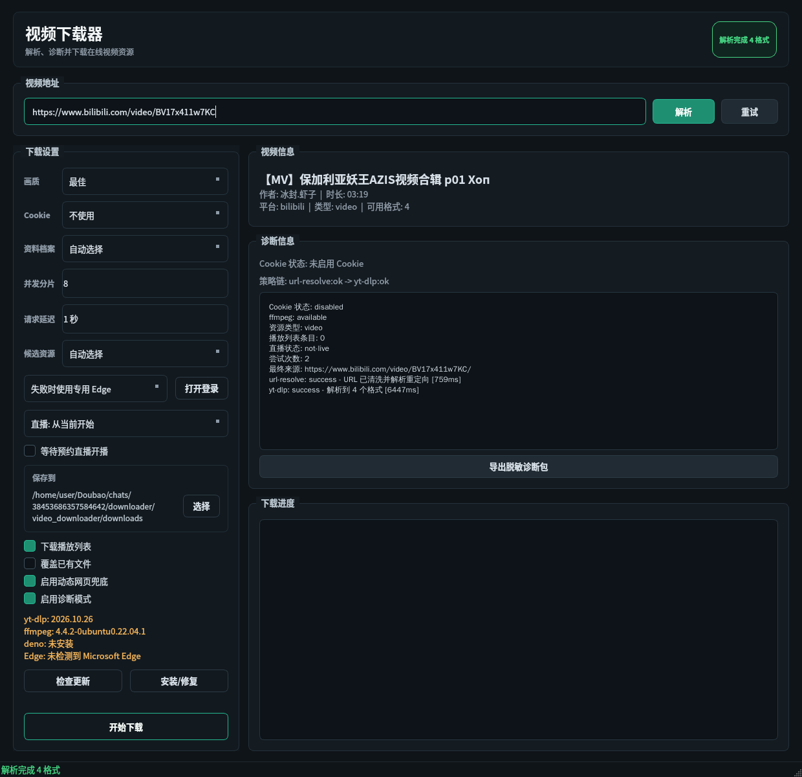
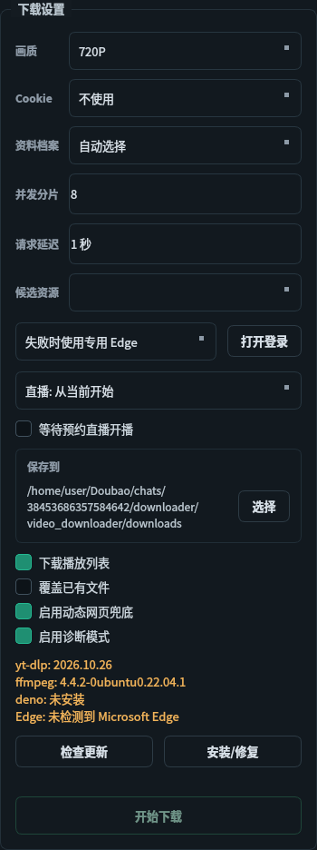
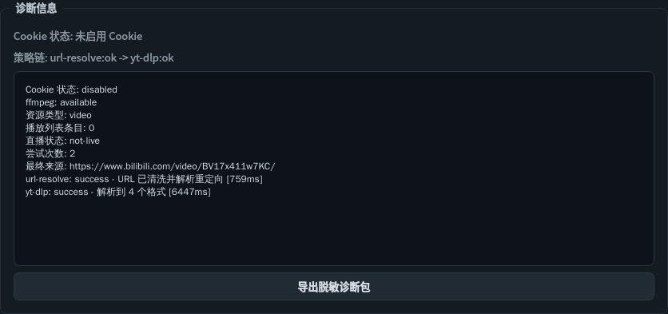

# 视频下载器 · Video Downloader

> 粘贴链接、解析、下载，让多平台在线视频可离线保存。一个以 [yt-dlp](https://github.com/yt-dlp/yt-dlp) 为核心引擎、[PySide6](https://www.qt.io/developers/) 构建的 Windows 桌面工具。

一个可直接运行的图形化视频下载器：粘贴网页或视频链接即可解析标题、作者、时长与全部可用格式，按需选择画质并下载，音视频自动合并为 MP4；内置播放列表勾选、浏览器 Cookie 读取、专用 Edge 的 CDP 媒体嗅探、运行时组件自管理，以及全程自动脱敏的诊断与容错链路。下载任务在后台线程执行，界面实时刷新进度且不卡顿。

---

## 界面速览

> 以下均为程序真实运行界面的截图（在 Linux 离屏环境中渲染同一份代码与 QSS 样式，故「运行环境」面板显示 `deno` / Edge 未检测；在 Windows 首次运行时会自动下载并安装 `yt-dlp`、`ffmpeg`、`Deno`，详见 [§5 运行时自管理](#5-运行时自管理)）。

<table>
  <tr>
    <th align="center">主界面 · 就绪</th>
    <th align="center">实时解析 · 视频信息与诊断</th>
  </tr>
<tr>
    <td></td>
    <td></td>
  </tr>
</table>

<table>
  <tr>
    <th align="center">下载设置 · 运行时状态</th>
    <th align="center">诊断信息 · 自动脱敏</th>
  </tr>
  <tr>
    <td align="center"></td>
    <td></td>
  </tr>
</table>

上图右侧解析结果来自对一个真实 Bilibili 链接的实时 `yt-dlp` 解析：标题、UP 主、时长、平台、可用格式数量，以及 `url-resolve -> yt-dlp` 的策略链与每一步耗时均为程序实际输出，而非占位演示数据。

---

## 1. 功能特性

- **多平台支持**：内置 YouTube、Bilibili（哔哩哔哩）、抖音、腾讯视频、小红书、快手的请求头与限流配置；其余 `yt-dlp` 支持的站点可直接解析，普通网页还能通过 HTML / CDP 兜底扫描提取媒体直链。
- **画质选择**：提供「最佳 / 1080P / 720P / 480P / 360P」预设，解析后按实际格式刷新；有 `ffmpeg` 时走 `bestvideo+bestaudio` 分离下载并合并，无 `ffmpeg` 时自动回退到音视频合一的单文件格式。
- **播放列表与直播**：支持整份播放列表下载，或在列表中勾选指定条目（`--playlist-items`）；直播可选择「从当前开始 / 支持时从头开始」，并可等待预约直播开播（`--wait-for-video`）。
- **浏览器 Cookie**：自动读取 Chrome / Edge / Firefox 的 Cookie，支持 `Default` 与 `Profile 1`–`Profile 5` 资料档案，并实时显示「可读取 / 未识别浏览器 / Cookie 存储缺失 / 可能已过期」等可读状态，用于登录或会员可见内容。
- **专用 Edge 媒体捕获**：在 `%LOCALAPPDATA%\VideoDownloader\EdgeProfile` 维护一份应用专属 Edge 档案，通过 CDP（Chrome DevTools Protocol）启动会话、自动触发播放并嗅探 `m3u8` / `mpd` / `mp4` 等媒体请求；识别到 Widevine / PlayReady / FairPlay 等 DRM 授权请求时直接判定为受限，**不会尝试绕过**。
- **运行时自管理**：首次运行自动把 `yt-dlp`、`ffmpeg`/`ffprobe`、`Deno` 下载安装到 `%LOCALAPPDATA%\VideoDownloader\runtime`，每个产物经 SHA-256 校验与健康检查后才激活，保留上一版本支持一键回滚，无需手动配置环境变量。
- **多级解析策略链**：URL 清洗重定向 → `yt-dlp` → 通用提取器 → 浏览器指纹模拟（`--impersonate`）→ 静态 HTML 媒体扫描 → 专用 Edge CDP 动态嗅探，逐级兜底，并记录每条策略的成败、分类与耗时。
- **诊断与容错**：把底层异常归类为网络、需要登录、Cookie 失效、无可用格式、受限、缺少 `ffmpeg` / 依赖等中文可读提示；内置重试与指数退避；诊断信息对 URL、请求头、Cookie、Token、签名等自动脱敏，可导出仅保存在本地的 ZIP 诊断包。
- **图形界面与多线程**：基于 PySide6 的深色界面，解析、下载、运行时安装分别运行在 `QThread` 后台线程，通过信号回传进度；支持任务取消（在 Windows 上终止整个进程树），界面不卡顿。

## 2. 环境要求

- **操作系统**：Windows 10 / 11（运行时组件与浏览器 Cookie / CDP 能力面向 Windows 路径设计）。
- **Python**：3.11 及以上。
- **网络**：首次运行需要联网，用于自动下载 `yt-dlp`、`ffmpeg`、`Deno`；日常解析与下载同样需要可访问目标站点的网络。
- **运行依赖**：仅 `PySide6>=6.6` 与 `websocket-client>=1.8`（见 `requirements.txt`）；`yt-dlp` / `ffmpeg` / `Deno` 不要求预装，由程序自管理。

## 3. 快速启动

```powershell
# 1) 克隆仓库并进入主程序目录
git clone https://github.com/Guzifeng0613/downloader.git
cd downloader/video_downloader

# 2) 创建并激活虚拟环境
python -m venv .venv
.\.venv\Scripts\Activate.ps1

# 3) 安装运行依赖
pip install -r requirements.txt

# 4) 启动图形界面
python main.py
```

启动后在「视频地址」输入框粘贴链接，选择画质与 Cookie 来源后点击「解析」，确认视频信息与候选资源无误，再点击「开始下载」即可。

- **保存位置**：默认保存在 `video_downloader/downloads/<视频标题>/<视频标题>.<ext>`，也可在「下载设置 → 保存到」中自行选择输出目录。
- **合并输出**：分离的音视频统一合并为 MP4（`--merge-output-format mp4`），并启用 Windows 安全文件名（`--windows-filenames`）。
- **并发与限速**：可在界面设置 1–16 的并发分片数与 0–5 秒请求延迟；各平台另有 0.25–0.5 秒的默认请求间隔，取两者较大值，降低触发风控的概率。

## 4. 解析策略链与错误分类

解析并不是只调用一次 `yt-dlp`。`DownloadService.parse()` 会按固定顺序逐级尝试，并把每一步写入 `ParseAttempt`（策略名、是否成功、错误分类、候选数量、耗时），最终汇总为界面可见的「策略链」与诊断摘要。

| 顺序 | 策略 | 作用 | 失败后的去向 |
| --- | --- | --- | --- |
| 1 | `url-resolve` | 清洗输入、剥离引号，并跟随重定向得到最终 URL | 记录网络类失败后继续 |
| 2 | `yt-dlp` | 用站点专属提取器 `--dump-single-json` 解析 | 进入下一策略 |
| 3 | `yt-dlp-generic` | 强制通用提取器（`--force-generic-extractor`） | 进入下一策略 |
| 4 | `yt-dlp-impersonate` | 通用提取器 + `--impersonate chrome` 模拟浏览器指纹 | 转入网页扫描 |
| 5 | `html-scan` | 抓取页面 HTML，解析 `<video>/<source>` 标签与 JSON 中的 `m3u8/mpd/mp4/webm/flv/mov` 地址并校验打分 | 进入动态嗅探 |
| 6 | `dynamic-scan` | 启动专用 Edge CDP 会话，监听真实媒体请求并回传请求头 / Cookie | 仍失败则抛出归类后的错误 |

底层异常经 `classify_error()` 转换为面向用户的中文结果，`DownloadCategory` 分类如下：

| 分类 | 典型触发 | 是否可恢复 / 处理建议 |
| --- | --- | --- |
| `network` | 超时、连接、DNS、SSL、代理、HTTP 5xx | 可重试，检查网络后自动 / 手动重试 |
| `auth_required` | 提示登录、401/403、私密内容且未选 Cookie | 选择已登录的浏览器 Cookie 后重试 |
| `cookie_error` | 已选 Cookie 但无效、过期或无法读取 | 切换资料档案，或完全退出浏览器后重试 |
| `no_format` | 无可下载格式、无法提取、URL 不支持 | 尝试开启动态网页兜底或更换链接 |
| `restricted` | DRM、付费墙、版权、地区限制、会员加密 | **不可恢复，工具不会绕过限制** |
| `ffmpeg_missing` | 合并 / HLS / DASH 流缺少 `ffmpeg` | 在运行环境面板「安装 / 修复」 |
| `missing_dependency` | 缺少独立 `yt-dlp.exe` 等托管组件 | 安装运行时后重试 |
| `unsupported` / `unknown` | 空输入、非 HTTP(S) 链接、其他未归类错误 | 按提示修正输入或查看诊断日志 |

> 下载阶段若遇到签名地址过期（HTTP 403/410），程序会通过 Edge 重新捕获新的媒体地址后断点续传，无需从头再来。

## 5. 运行时自管理

`RuntimeManager` 在用户目录下维护一套与系统隔离、可独立升级的运行时，不污染全局环境变量。

| 组件 | 来源 | 用途 |
| --- | --- | --- |
| `yt-dlp` | GitHub Releases 的 `yt-dlp.exe`（校验 `SHA2-256SUMS`） | 核心解析与下载引擎，以独立子进程方式调用 |
| `ffmpeg` / `ffprobe` | gyan.dev 的 essentials 构建包（校验 `.sha256`） | 音视频合并、HLS / DASH 流处理 |
| `Deno` | GitHub Releases 的 Windows ZIP（校验 `.sha256sum`） | 作为 `yt-dlp` 的 JavaScript 运行时（`--js-runtimes deno:<path>`），配合 `--remote-components ejs:github` 运行需要执行 JS 的提取器 |

- **安装位置**：根目录 `%LOCALAPPDATA%\VideoDownloader\runtime`，激活版本记录在 `active.json`，EJS 插件放在 `runtime/plugins`。
- **安全校验**：所有归档先做 SHA-256 比对，ZIP 使用路径安全解压（阻止目录穿越），激活前先执行 `--version` / `-version` 健康检查，并拒绝激活运行时目录之外的文件。
- **版本与回滚**：激活新版本时保留上一版本；若当前版本健康检查失败且旧版本健康，会自动回滚，也可在界面手动「安装 / 修复」。
- **检查更新**：「检查更新」会查询各来源的最新版本号并提示差异；整个下载过程带进度回调，界面实时显示已下载 / 总大小与百分比。

## 6. 浏览器 Cookie 与 CDP 媒体捕获

- **Cookie 来源**：`--cookies-from-browser chrome|edge|firefox[:profile]`，资料档案可在 `Default`、`Profile 1`–`Profile 5` 间切换；`Config` 内置各浏览器在 Windows 下的 Cookie 存储与可执行文件发现路径。
- **状态探测**：解析前先检测浏览器是否安装、Cookie 存储是否存在，映射为 `disabled / available / browser_not_found / cookie_store_not_found / read_failed / maybe_expired` 六种状态并展示。
- **专用 Edge 档案**：与日常浏览器隔离的独立 `user-data-dir`，可点击「打开登录」手动完成登录或人机验证；捕获时开启远程调试端口与 `Network.enable`，自动播放页面中的 `<video>` 并筛选媒体类请求。
- **请求上下文回放**：嗅探到的媒体地址会带上原页面的 `Referer`、`Origin`、`User-Agent` 与同域 Cookie 再交给 `yt-dlp`，提高签名 / 防盗链地址的成功率；`blob:` 等不可直接下载的地址会被过滤。
- **DRM 红线**：URL 或请求命中 `widevine`、`playready`、`fairplay`、`license`、`drm` 等标记时，资源被标记为受限并提示用户，工具不提供任何解密或绕过能力。

## 7. 隐私保护与诊断脱敏

诊断能力默认开启，但所有可能外泄的信息在进入界面或导出文件前都会经过 `downloader/diagnostics.py` 处理：

- **URL 脱敏**：`redact_url()` 保留 URL 结构，但把 `token`、`signature`、`sig`、`credential`、`x-amz-*` 等查询参数值替换为 `[REDACTED]`，并去除用户名口令。
- **请求头 / 正文脱敏**：`Authorization`、`Cookie`、`Set-Cookie`、`X-Api-Key` 等头部整体掩码，`Bearer` / `Basic` 凭证正则替换，正文中出现的 URL 同样逐条脱敏。
- **递归序列化**：`redact_value()` 会递归处理 dataclass、字典与列表，候选资源、请求上下文等结构在送往 UI 前不含任何凭证字段。
- **本地诊断包**：`export_diagnostic_bundle()` 仅在用户选择的本地路径写出 ZIP（含 `diagnostics.json`、`summary.txt`、`log.txt`），载荷中显式标记 `telemetry_uploaded: false`，不做任何上报。

## 8. 目录结构

```text
downloader/
├── README.md
├── .gitignore
├── docs/
│   └── screenshots/             # 本文使用的真实界面截图
└── video_downloader/            # 主程序
    ├── main.py                  # GUI 入口（QApplication + MainWindow）
    ├── config.py                # 全局配置：平台请求头/限流画像、浏览器与 ffmpeg 路径
    ├── errors.py                # 错误分类（ErrorCategory / ErrorHandler）
    ├── retry.py                 # 指数退避异步重试装饰器
    ├── requirements.txt         # 运行依赖（PySide6、websocket-client）
    ├── requirements-dev.txt     # 开发依赖（追加 pytest）
    ├── DOCKER_DEPLOYMENT.md      # Docker 打包与异机部署说明
    ├── downloader/              # 下载核心
    │   ├── service.py           # yt-dlp 优先的统一下载服务（策略链、格式归一、错误归类）
    │   ├── runtime.py           # yt-dlp / ffmpeg / Deno 的下载、校验、激活与回滚
    │   ├── browser.py           # 专用 Edge 档案与 CDP 媒体请求捕获
    │   └── diagnostics.py       # 诊断信息收集与脱敏、本地诊断包导出
    ├── ui/                      # PySide6 图形界面
    │   ├── main_window.py       # 主窗口、主题 QSS 与全部交互
    │   ├── threads.py           # ParseTask / DownloadTask / RuntimeTask 后台线程
    │   └── progress_manager.py  # 多任务进度聚合与格式化
    ├── platforms/               # 平台扩展（预留）
    ├── utils/                   # 通用工具（预留）
    └── tests/                   # pytest 测试（共 31 个用例）
        ├── test_compatibility.py
        └── test_download_service.py
```

## 9. 测试

```powershell
cd video_downloader
pip install -r requirements-dev.txt
pytest
```

共 **31** 个 pytest 用例（`test_download_service.py` 19 个、`test_compatibility.py` 12 个），不依赖真实网络即可覆盖核心逻辑，主要包括：

- **命令构建**：独立运行时路径、直播 / 播放列表参数、Cookie 开关、平台请求延迟、有无 `ffmpeg` 时的格式选择器。
- **解析与候选**：HTML 扫描器的媒体地址提取与优先级、候选资源打分（master 清单优先、分片 / 广告地址降权）、播放列表条目不丢失、候选数据可 JSON 序列化且不含凭证。
- **错误归类**：未选 / 已选 Cookie 的鉴权错误、受限内容、空输入拒绝、Cookie 状态探测。
- **安全与运行时**：脱敏函数对敏感诊断的处理、运行时不健康版本自动回滚、PowerShell 风格哈希校验解析、运行时安装任务的进度上报、DRM 授权请求识别，以及一个调用真实独立 `yt-dlp` 进程返回结构化 JSON 的兼容性用例。

## 10. Docker 打包与异机部署

本项目是桌面 GUI 程序，普通 Windows 用户建议直接运行源码，或使用 PyInstaller 等工具打包为 `.exe`。如确需通过 Docker 在异机部署（容器内运行 GUI 需要额外配置 X11 / 显示服务，且无法直接读取宿主机浏览器 Cookie），请参阅 [`video_downloader/DOCKER_DEPLOYMENT.md`](video_downloader/DOCKER_DEPLOYMENT.md)，其中包含 Dockerfile、`.dockerignore`、Windows / Linux / macOS 的 X Server 运行方式、`docker save/load` 异机分发、compose 编排与常见问题排查。

## 11. 已知边界

1. 运行时自管理、浏览器 Cookie 读取与 CDP 捕获均面向 **Windows** 路径与 `yt-dlp.exe` / `ffmpeg.exe` / `deno.exe`；在其他系统上依赖 PATH 中已有的同名可执行文件，专用 Edge 能力不可用。
2. 程序**不绕过** DRM、付费墙、版权与地区限制；命中这类保护时只会提示资源受限，不提供解密手段。
3. 浏览器 Cookie 读取可能受浏览器占用或数据库锁定影响，失败时需完全退出浏览器或切换资料档案后重试；容器环境默认无法复用宿主机 Cookie。
4. 部分站点的高清格式或登录可见内容依赖有效 Cookie，匿名解析时可用画质可能受限。
5. 自动安装运行时需要能访问 GitHub 与 gyan.dev 的网络；离线环境需自行准备对应可执行文件并放入运行时目录。

---

## 免责声明

本工具仅供个人学习、技术研究以及合法下载自有或已获授权的内容使用。请遵守各视频平台的服务条款及相关版权法律法规，自行承担下载与使用行为的责任，勿用于任何侵权、违规或商业用途。
